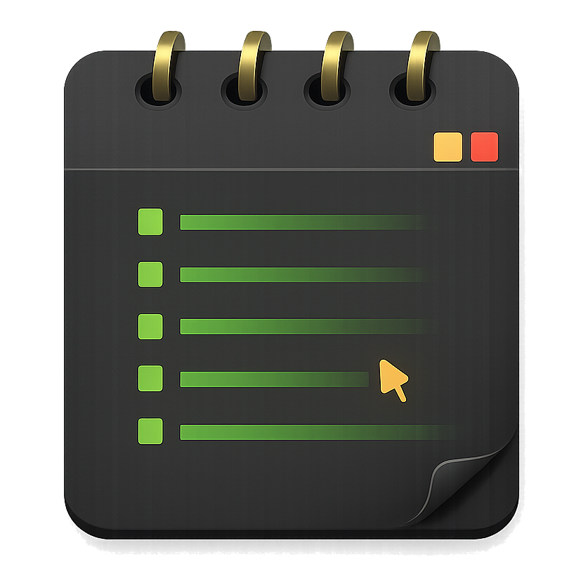

<p align="center">
  <a href="https://github.com/brunonlinespace/nuxpad">
    
  </a>
</p>

# Nuxpad 2

**Friendly. Fast. Focused.**

Nuxpad 2 is a lightweight plain-text editor for Linux and Windows, built with Python and PyQt6 from one shared source. It focuses on ordinary text files, fast editing, straightforward navigation, and careful preservation of file encoding and line endings without introducing a private document format.

Current release: **2.2.8**

Repository: <https://github.com/brunonlinespace/nuxpad>

## What Nuxpad is

Nuxpad is designed as a small, direct text editor rather than a rich-text or workspace application. Documents remain ordinary files on disk and can be opened, edited, renamed, printed, or passed to Nuxpad from the command line.

Nuxpad accepts regular text files up to **25 MiB**. Binary-looking files are rejected rather than loaded into the editor.

Save As defaults extensionless names to `.txt`, while explicit extensions such as `.log`, `.md`, `.json`, or `.py` are preserved.

## Highlights

- Lightweight **plain-text editing** using Qt's plain-text editor.
- One shared application source for **Linux and Windows**.
- **New, Open, Save, Save As, Rename, Print, and New Window** workflows.
- Multiple command-line files open in independent Nuxpad windows.
- Configurable **drag and drop**: open on the active window or in new windows.
- **Word Wrap** and **Line Numbers**.
- Native **Status Bar** with the current file path plus live Lines and Chars counters.
- Four configurable interface layouts for toolbar and search placement.
- **Menu Only** mode for using the native application menu bar instead of toolbar menu buttons.
- Case-insensitive **Find** with highlighted matches, previous/next navigation, and a 10,000-match display cap.
- **Replace** and **Replace All**, with optional case matching.
- **Go To Line**.
- `• List` insertion for simple plain-text bullet lists.
- Curated **Symbols** popup plus access to the operating system's character-map utility.
- **Date**, **Time**, and **Date + Time** insertion.
- Classic Notepad-style **`.LOG`** timestamp behavior.
- Preservation of detected **encoding, BOM, and predominant line endings** when saving.
- Atomic ordinary-file saves with secure temporary files.
- SHA-256 based detection of files changed externally before Nuxpad overwrites them.
- Configurable print-only **headers and footers** with filename, page, date, time, application, and confidentiality placeholders.
- **Dark / Light** application shell themes across supported builds.
- Optional **Chicago95/Raleigh** Retro styling: Chicago95 in Light, Raleigh-derived styling in Dark.
- Independent **Dark Editor** canvas setting, separate from the application shell theme.

## Interface

Nuxpad keeps its command structure intentionally compact:

**File · Edit · View · Help**

### File

- **New**
- **Open…**
- **Save**
- **Save As…**
- **Rename…**
- **Page Setup…**
- **Print…**
- **New Window**
- **Exit**

### Edit

- **Undo**
- **Redo**
- **Cut**
- **Copy**
- **Paste**
- **Date + Time**
- **Date Only**
- **Time Only**
- **Select All**
- **Go To Line…**
- **Replace…**

Find is available directly from the search field and with **Ctrl+F**.

### View

- **Menu Only**
- **Status Bar**
- **Word Wrap**
- **Line Numbers**
- **Dark Editor**
- **Layout** — mutually exclusive radio choices
  - ○ Inline — Top
  - ○ Inline — Bottom
  - ○ Split — Toolbar Up / Search Down
  - ○ Split — Toolbar Down / Search Top
- **Drag-and-Drop** — mutually exclusive radio choices
  - ○ Opens on Active Window
  - ○ Opens on New Window
- **Theme**
  - ○ Dark
  - ○ Light
  - ✓ Chicago95/Raleigh — toggles the Retro style apparatus on or off
- **Display Font…**

### Help

- **Documentation**
- **Keyboard Shortcuts**
- **GitHub Repository**
- **Raise an Issue**
- **About Nuxpad 2**

The main editing surface also provides dedicated **`• List`** and **`† Symbols`** buttons.

## Search and replace

The main Find field performs a literal, case-insensitive search and highlights every retained match without moving the editing cursor.

- **Previous** and **Next** move through the retained matches and wrap at the ends.
- Nuxpad retains and highlights up to **10,000** matches to keep extreme searches bounded.
- Editing the document clears the current search results so stale highlights are not left behind.
- **Replace…** is a separate modeless dialog with Replace, Replace All, and **Match case**.

## Plain-text file handling

Nuxpad opens UTF-8 directly and recognises BOM-marked:

- UTF-8
- UTF-16 LE / BE
- UTF-32 LE / BE

For non-UTF-8 text without a BOM, Nuxpad can ask the user to choose:

- Windows-1252
- ISO-8859-1
- UTF-16 LE
- UTF-16 BE
- the system encoding

When a document is saved, Nuxpad preserves its detected encoding and BOM. It also preserves the predominant original line-ending style:

- LF
- CRLF
- CR

If newly entered text cannot be represented in the document's existing encoding, Nuxpad cancels the save rather than silently replacing characters.

## Safe saving and external changes

Ordinary files are saved through a secure temporary file followed by replacement of the original file. Existing standard permission bits are retained where supported.

Symbolic links are deliberately written through so the link itself remains intact.

Nuxpad records a SHA-256 signature of the exact file bytes it opened or last wrote. Before saving over an existing document, it checks the disk copy again. When the file has changed externally, Nuxpad offers:

- **Reload**
- **Save As…**
- **Overwrite**
- **Cancel**

This protects against blindly overwriting another program's changes.

## Drag and drop

Nuxpad accepts local files dropped into the application.

**View → Drag-and-Drop** chooses between:

- ○ **Opens on Active Window**
- ○ **Opens on New Window**

In active-window mode, Nuxpad uses the normal unsaved-changes prompt before replacing the current document. When several accepted files are dropped together, the first uses the active window and the remaining files open in new windows.

Files that fail Nuxpad's regular-file, size, or text checks are skipped.

## Lists, symbols, dates, and `.LOG`

### List

**`• List`** inserts a plain-text bullet:

- an empty line becomes `• `;
- an existing bullet item creates the next bullet;
- a normal paragraph receives `• ` at its beginning.

### Symbols

The **`† Symbols`** popup contains a curated set of common symbols. **More Symbols…** opens an available host character-map application:

- Windows: **Character Map**
- Linux: **KCharSelect**, **GNOME Characters**, **Gucharmap**, or another supported `charmap` command when available

### Date and time

Nuxpad can insert the system-local:

- date;
- time;
- date and time.

### `.LOG`

When the first line of an opened document is exactly:

```text
.LOG
```

Nuxpad appends a locale-aware date-and-time stamp at the end of the document, marks the document modified, and leaves it ready for typing. The file is not auto-saved.

## Printing

Nuxpad uses the native Qt print dialog.

**Page Setup…** controls optional print-only headers and footers with separate left, centre, and right fields.

Supported placeholders are:

| Placeholder | Meaning |
| --- | --- |
| `&F` | Filename |
| `&P` | Current page |
| `&N` | Total pages |
| `&D` | Date |
| `&T` | Time |
| `&A` | Application name |
| `&C` | `Confidential` |

Headers and footers affect printed output only; they are not inserted into the text document.

## Appearance

Nuxpad uses its own application-shell theme on supported builds while leaving external operating-system dialogs native and unthemed.

A fresh configuration starts with the **modern LinSpectacles style**, **Dark** selected, and **Chicago95/Raleigh** turned off. The **Dark Editor** canvas is also on by default and remains independent of the shell theme.

**View → Theme** uses two different kinds of selector:

- ○ **Dark** and ○ **Light** are mutually exclusive theme variants.
- ✓ **Chicago95/Raleigh** is a checkmark because it activates or deactivates the Retro style apparatus; it is not a third theme variant.

The resulting combinations are:

| Chicago95/Raleigh | Theme | Result |
| --- | --- | --- |
| Off | Dark | LinSpectacles Dark |
| Off | Light | LinSpectacles Light |
| On | Dark | Raleigh-derived Retro Dark |
| On | Light | Chicago95 Light |

The Retro styles are based on [Chicago95](https://github.com/grassmunk/chicago95) and [Raleigh](https://github.com/thesquash/gtk-theme-raleigh).

**View → Dark Editor** independently switches the editor canvas between dark and light without changing the application shell.

The default interface state is **Menu Only on**, **Status Bar on**, **Word Wrap on**, **Line Numbers on**, **Inline — Top** layout, and **Drag-and-Drop → Opens on Active Window**. The default display font is **Sans Serif 11**, normal/roman.

## Useful keyboard shortcuts

| Shortcut | Action |
| --- | --- |
| `Ctrl+N` | New |
| `Ctrl+O` | Open |
| `Ctrl+S` | Save |
| `Ctrl+Shift+S` | Save As |
| `F2` | Rename |
| `Ctrl+Shift+P` | Page Setup |
| `Ctrl+P` | Print |
| `Ctrl+Shift+N` | New Window |
| `Ctrl+Q` | Exit |
| `Ctrl+Z` | Undo |
| `Ctrl+Y` | Redo |
| `Ctrl+X` | Cut |
| `Ctrl+C` | Copy |
| `Ctrl+V` | Paste |
| `Ctrl+A` | Select All |
| `Ctrl+L` | List |
| `F5` | Date + Time |
| `Ctrl+;` | Date Only |
| `Ctrl+:` | Time Only |
| `Ctrl+F` | Find |
| `Ctrl+G` | Go To Line |
| `Ctrl+H` | Replace |
| `Ctrl+Alt+Shift+M` | Menu Only |
| `Ctrl+Alt+Shift+S` | Status Bar |
| `Ctrl+Alt+Shift+W` | Word Wrap |
| `Ctrl+Alt+Shift+L` | Line Numbers |
| `Ctrl+Alt+Shift+E` | Dark Editor |
| `F1` | Documentation |

The current shortcut inventory is also available from **Help → Keyboard Shortcuts**.

## Running from source

Nuxpad requires **Python 3** and **PyQt6** on the host.

From the repository root:

Linux:

```bash
./nuxpad2/portable/run-nuxpad.sh
```

or directly:

```bash
python3 main.py
```

Windows Command Prompt:

```bat
nuxpad2\portable\run-nuxpad.cmd
```

Windows PowerShell:

```powershell
.\nuxpad2\portable\run-nuxpad.ps1
```

All source forms use the same Nuxpad application and theme system.

## Building the Linux AppImage

The Fedora AppImage builder supports native **x86_64** and **aarch64** builds and is validated on **Fedora 43 and Fedora 44**. Cross-building between architectures is intentionally unsupported.

From the repository root:

```bash
chmod +x nuxpad2/packaging/fedora/build-appimage.sh
./nuxpad2/packaging/fedora/build-appimage.sh
```

Expected outputs are written under `nuxpad2/dist/` for the current host architecture, including:

```text
nuxpad2/dist/Nuxpad-2.2.8-<arch>.AppImage
nuxpad2/dist/Nuxpad-2.2.8-<arch>.AppImage.sha256
nuxpad2/dist/Nuxpad-2.2.8-<arch>.build-info.txt
nuxpad2/dist/Nuxpad-2.2.8-<arch>.build-python-lock.txt
```

The builder creates an isolated Python environment, freezes the canonical application source with PyInstaller, assembles the AppDir, validates important Qt components, performs smoke checks, and records build information.

## Building the Windows portable package

Nuxpad includes a PowerShell/PyInstaller helper for a self-contained **Windows x64** folder package.

From the repository root:

```powershell
Set-ExecutionPolicy -Scope Process Bypass
.\nuxpad2\windows\build-windows-portable.ps1
```

The packaging format is a portable folder plus ZIP. It does not install file associations or create application registry entries.

## Configuration

Linux:

```text
~/.config/brunonlinespace/nuxpad2/nuxpad.json
```

Windows:

```text
%APPDATA%\brunonlinespace\Nuxpad2\nuxpad.json
```

Preferences include interface layout, word wrap, line numbers, status-bar visibility, drag-and-drop behaviour, Dark/Light application theme, the Chicago95/Raleigh Retro-style toggle, the independent Dark Editor setting, display font, and print header/footer settings.

## Current supported build targets

- Fedora 43 — native x86_64 or aarch64 AppImage build
- Fedora 44 — native x86_64 or aarch64 AppImage build
- Windows 11 x64 — portable package

The source tree also records planned compatibility expansion separately from these current validated build targets.

## Scope

Nuxpad is a **plain-text editor**. It does not currently provide rich-text formatting, embedded images, PDF viewing, workspaces, tabs, syntax highlighting, Markdown preview, plugins, or project-management features.

That limited scope is intentional: Nuxpad is meant to remain a small editor for ordinary text files.

## License

Nuxpad 2 is licensed under the **GNU General Public License v3.0 or later**.

See `LICENSE` for the complete licence text.

## Links

- Nuxpad 2: <https://github.com/brunonlinespace/nuxpad>
- GitHub profile: <https://github.com/brunonlinespace/>

Copyright © 2026 Bruno Machado.
